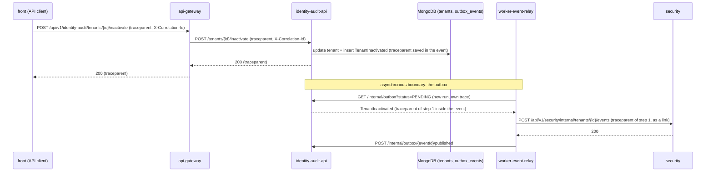

# CP1 - Critical journey and trace map

## Journey

**A Platform Administrator inactivates a tenant, and the sessions of that tenant stop working.**

It is the journey where a user action in one service has to change the state of another service without a
shared transaction: the tenant lives in `identity-audit` (MongoDB), but the accounts and sessions live in
`security` (PostgreSQL). The only link between the two is an event. If that event is late or lost, a tenant
that was inactivated keeps signing in, which is the failure I most want to see in a trace.

It crosses six components: the front, the gateway, `identity-audit` API, its outbox, the event relay (job 7)
and `security`. Sources in the team's Docs repository: `07-api/contracts/openapi/identity-audit.yaml`
(`inactivateTenant`, `listOutboxEvents`), `07-api/contracts/openapi/security.yaml` (`receiveTenantEvent`) and
ADR-004 D4 (outbox and event envelope) and D5 (inactivation cuts the sessions).

## Hop table

| Step | Caller | Callee | Protocol | Operation | Sync/Async | Data |
|---|---|---|---|---|---|---|
| 1 | `multi-tour-front` (API client) | `multi-tour-api-gateway` | REST | `POST /api/v1/identity-audit/tenants/{tenantId}/inactivate` with `{ "reason": ... }` | sync | none |
| 2 | `multi-tour-api-gateway` | `multi-tour-identity-audit-api` | REST | `POST /tenants/{tenantId}/inactivate` (port 8082) | sync | none |
| 3 | `multi-tour-identity-audit-api` | MongoDB, database of `identity-audit` | MongoDB wire | update the tenant status and insert the `TenantInactivated` event in the outbox, one transaction | sync | collections `tenants` and `outbox_events` |
| 4 | `multi-tour-worker-event-relay` | `multi-tour-identity-audit-api` | REST | `GET /internal/outbox?status=PENDING` (the relay polls, `RELAY_INTERVAL` = 5 s) | async to step 1 | none |
| 5 | `multi-tour-worker-event-relay` | `multi-tour-security` | REST | `POST /api/v1/security/internal/tenants/{tenantId}/events`, `Idempotency-Key` = event id | async to step 1 | the copy of the tenant in schema `security` |
| 6 | `multi-tour-worker-event-relay` | `multi-tour-identity-audit-api` | REST | `POST /internal/outbox/{eventId}/published` | async to step 1 | `outbox_events` |

The asynchronous boundary is between step 3 and step 4: the person's request ends at step 3 with `200`, and
the relay picks the event up on a later run. There is no broker; the outbox collection is the queue.

## Sequence diagram



Trace context on each arrow: every synchronous arrow carries the W3C `traceparent` header
(`00-<trace_id>-<span_id>-01`) and the team's `X-Correlation-Id`. Across the outbox the context travels
inside the event, not in a header: the `traceparent` of step 1 is stored with the event at step 3, and the
relay reads it at step 4 to continue the same `trace_id`.

## Span tree

One `trace_id` for the whole journey. Indented = child of the line above.

```
inactivate-tenant                                   (root span, front API client, step 1)
  POST /api/v1/identity-audit/tenants/{id}/inactivate   (gateway, step 1 to 2)
    POST /tenants/{id}/inactivate                        (identity-audit-api, server span, step 2)
      mongo.tenants.update + outbox_events.insert        (identity-audit-api, step 3)
  --- asynchronous boundary: same trace_id, new run of the relay ---
  relay.run                                              (worker-event-relay, one run, step 4)
    GET /internal/outbox                                 (relay to identity-audit-api, step 4)
    relay.deliver TenantInactivated                      (relay, per event, step 5)
      POST /security/internal/tenants/{id}/events        (security, server span, step 5)
        postgres update of the tenant copy                (security, step 5)
    POST /internal/outbox/{eventId}/published            (relay to identity-audit-api, step 6)
```

The span that crosses the asynchronous boundary is `relay.deliver TenantInactivated`: it is a child of the
span of step 3 (same `trace_id`), even if it starts seconds later.

## What exists today and what is the target

| Part | Today in the code | Target of this workshop |
|---|---|---|
| `X-Correlation-Id` on every synchronous hop | Yes: the gateway, `security`, the Java API and the worker runtime reuse or create it | stays as the `correlation_id` field |
| `traceparent` header | No service reads or sends it | CP3 builds the middleware and the outbound injection (in the relay module) |
| Context inside the outbox event | The event envelope carries `correlationId`, not a `traceparent` (ADR-004 D4) | add a `traceparent` field to the envelope when the event is written |
| Spans and a store for them | No spans; Tempo is decided in ADR-004 D8 but not built | out of the workshop; the spans above are the design |

The table above is the honest state: the map is a design for the parts marked "target", and CP3 implements
the part that can be proven with one test.
