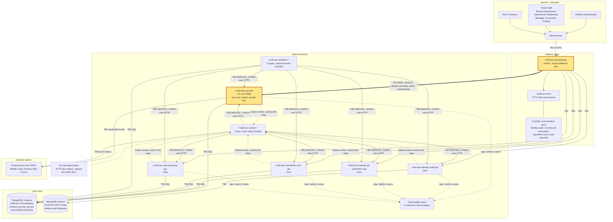

# CP1 - Attack surface of Multitour

Boundary I own: **TB2 `multi-tour-api-gateway` to `multi-tour-security`** (highlighted). Sources in
`multi-tour-docs`: `05-architecture/overview.md` (sections 2 to 4), `07-api/contracts/openapi/security.yaml`
and `06-data/models.md` ("Identity and access").

## Data flow and trust boundaries

| Boundary | Between | Who owns the analysis |
|---|---|---|
| TB1 | Internet and browser to the gateway | open |
| **TB2** | **Gateway to `multi-tour-security`** | **me (issue claimed)** |
| TB2 | Gateway to the four domain APIs | Fernanda takes gateway to `multi-tour-commercial-reservation-api` |
| TB3 | Services to their PostgreSQL schema or MongoDB database | open |
| TB4 | Services and workers to the SMTP service | open |
| TB5 | Workers and workflows to the service APIs (`SERVICE_TOKEN`) | open |

## Asset inventory (my boundary)

| Asset | Where it lives | Classification |
|---|---|---|
| RS256 private signing key | `multi-tour-security` only (ADR-004 D5) | restricted |
| `identities.passwordHash` (bcrypt, cost >= 12) | `security` schema in PostgreSQL | restricted |
| Access token (15 minutes) and refresh token (7 days, single use) | in transit gateway to security; `refresh_tokens.tokenHash` in `security` | restricted |
| Temporary credential of a new internal user (72 hours) | `security` schema, set by `POST /security/users` | restricted |
| E-mail verification link (24 hours) | in the e-mail to the Final Customer; hash in `security` | confidential |
| `identities.emailNormalized`, `memberships` and `membership_roles` | `security` schema in PostgreSQL | confidential |
| `AccountSessionsRevoked` event | outbox of `multi-tour-security` | internal |
| Tenant link identifier `/t/{identifier}` | URL given to customers | public |

## Entry points of TB2 (route, caller, authentication today)

| Route | Caller | Authentication today |
|---|---|---|
| `POST /security/public/tenants/{identifier}/sessions` | any browser | none; e-mail and password, one `401` for every refusal |
| `POST /security/public/platform/sessions` | Platform Administrator | none; e-mail and password |
| `POST /security/public/sessions/refresh` | any browser | none; opaque single-use refresh token |
| `PUT /security/sessions/password` | person with a temporary credential | Bearer, only `access: password-change` |
| `POST /security/public/tenants/{identifier}/accounts` | any visitor | none; `Idempotency-Key`, account created `PENDING` |
| `POST /security/public/tenants/{identifier}/email-verifications` | any visitor | none; always answers `202` |
| `POST .../email-verifications/confirmations` | page behind the e-mail link | link plus account password |
| `POST` and `GET /security/users` | Tenant Administrator | Bearer, role `TENANT_ADMINISTRATOR`, no access mark |
| `GET /tenants/{tenantId}/memberships`, `PATCH .../{membershipId}/status` | Platform or Tenant Administrator | Bearer, own tenant only |

Not routed by the gateway: `/security/internal/...` (tenant events, outbox, first administrator), reserved to the
`SERVICE` role and reached over TB5.

## Open question for CP2

`07-api/contracts/openapi/api-gateway.yaml` says the gateway adds `X-User-Id` and `X-User-Role` before forwarding,
while `overview.md` says each service validates the JWT by itself and the gateway only checks that a credential
exists. To check against the real gateway configuration before I score the spoofing row.
